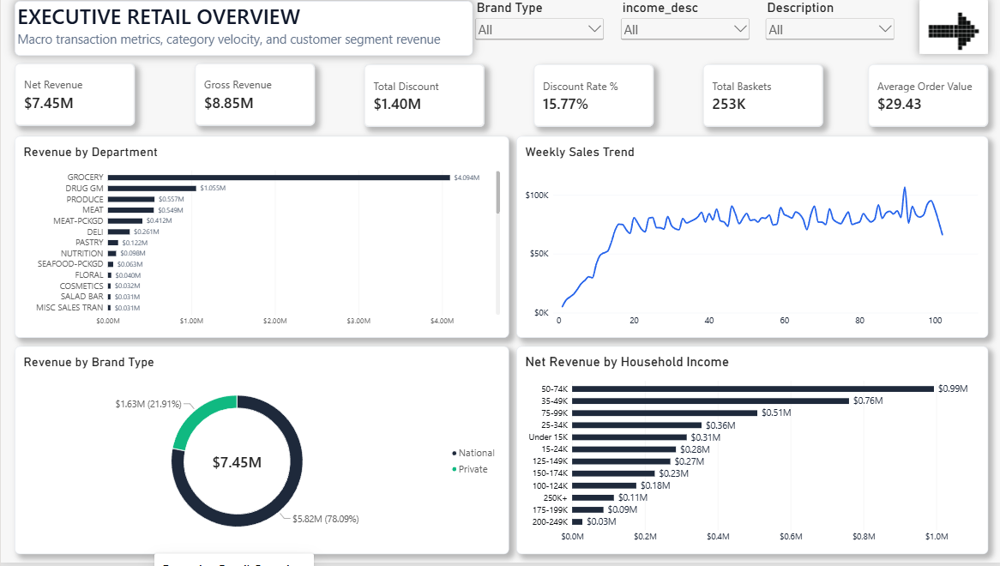
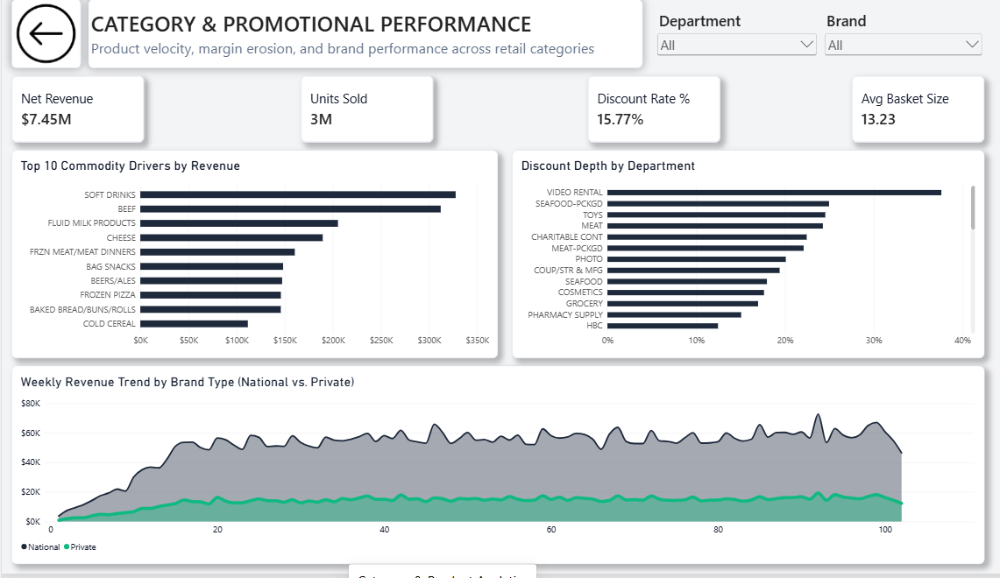

# 🛒 The Margin vs. Volume Paradox: Commercial Intelligence in Retail POS

> *A supermarket can easily register $7.45M in gross throughput while unknowingly bleeding margin to aggressive promotions[cite: 6]. When high checkout volume masks unchecked markdown depth, standard top-line totals conceal the business's actual fiscal health.*

This project analyzes **2.5M+ retail transactions across 2,500 households** from the **Dunnhumby Complete Journey** dataset. Moving beyond surface-level volume reporting, this two-page executive Power BI dashboard investigates the balance between **top-line sales velocity**, **markdown dependency**, and **private-label margin resilience**[cite: 5, 6].

---

### 💡 The Core Analytical Hook
* **Volume Masking Markdown Erosion:** While the **Grocery** department anchors baseline cash flow ($4.09M)[cite: 6], peripheral categories like **Toys** and **Video Rental** bleed upwards of **25% to 38% in promotional discount depth**, masking weak organic demand under clearance markdowns[cite: 5].
* **The Private-Label Advantage:** National brands account for 78.1% of gross sales ($5.82M), yet **Private Label** ($1.63M) maintains an unassisted, stable weekly velocity curve—offering margin protection without demanding steep price haircuts[cite: 5, 6].
* **The $3.34M Loyalty Gap:** Over **44% of total sales volume ($3.34M)** originated from non-demographic shoppers without registered loyalty accounts[cite: 6], identifying an immediate operational opportunity to convert transient traffic into tracked loyalty households.

---

## 📸 Executive Visual Architecture

### Page 1: Executive Retail Overview
*High-level revenue health, basket economics, department distribution, weekly trajectory, and verified household demographic spending.*

### Page 2: Category & Promotional Performance
*Operational commodity velocity, markdown dependency analysis, and longitudinal National vs. Private brand trajectory.*

---

## 💼 Business Problem & Executive Context

Retail category managers and merchandising directors constantly face margin vs. volume friction:

1. **Unmonitored Margin Erosion:** Markdowns and manufacturer promotions drive high checkout volume, but without tracking net discount depth, categories bleed gross margin without generating net revenue lift.
2. **Private Label Under-Utilization:** Retailers often under-leverage high-margin store brands (Private Label) against national CPG competitors, missing opportunities to insulate profitability during promotional periods.
3. **Long-Tail Noise:** Product catalogs with thousands of commodities dilute merchant attention away from the core 20% of product classes driving 80% of cash flow.
4. **Demographic Coverage Blindspots:** Blanket promotions fail to account for the fact that registered loyalty cardholders exhibit distinct basket sizes compared to unregistered/transient shoppers.

---

## 🔍 Key Data Insights & Analytical Findings

* **Top-Heavy Revenue Concentration:** The **Grocery** department alone generated **$4.09M (54.9%)** of total net revenue ($7.45M), followed by Drug General Merchandise ($1.05M)[cite: 6]. Commodity Pareto analysis showed that high-frequency staple categories (**Soft Drinks, Beef, Fluid Milk Products, and Cheese**) anchor baseline store baskets[cite: 5].
* **Severe Promotional Depth in Ancillary Categories:** While Grocery maintains a disciplined discount rate (~16–18%), non-core and discretionary categories exhibit steep margin haircuts[cite: 5]:
  * Categories like Video Rental, Packaged Seafood, and Toys exceeded **25%–38% discount depth**, highlighting heavy clearance-driven movement rather than organic volume pull[cite: 5].
* **National vs. Private Label Dynamic:**
  * National brands dominate overall sales volume (**78.1% / $5.82M**), but Private Label (**21.9% / $1.63M**) maintains steady, consistent weekly velocity without requiring the severe promotional price-slashing observed in top-tier national products[cite: 6].
* **Demographic Spending Distribution:**
  * Analysis of registered loyalty households revealed that the **$50K–$74K** income bracket is the primary demographic engine ($0.99M net sales), followed closely by the **$35K–$49K** segment ($0.76M)[cite: 6]. 
  * Transactions lacking loyalty linkage accounted for $3.34M in gross sales[cite: 6], identifying an immediate business case for front-end cashier prompts to expand loyalty program sign-ups.

---

## 🛠️ Data Pipeline & Technical Architecture
